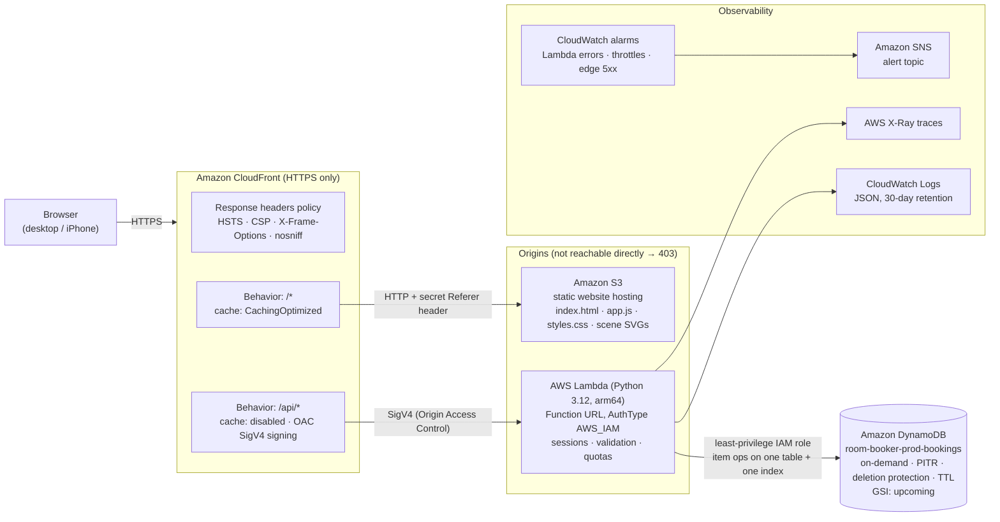
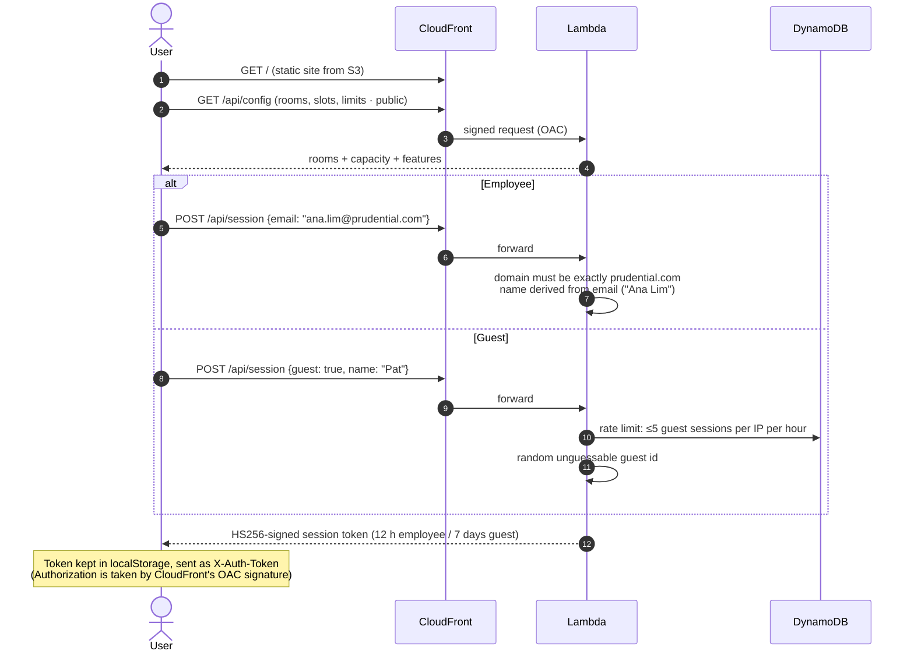
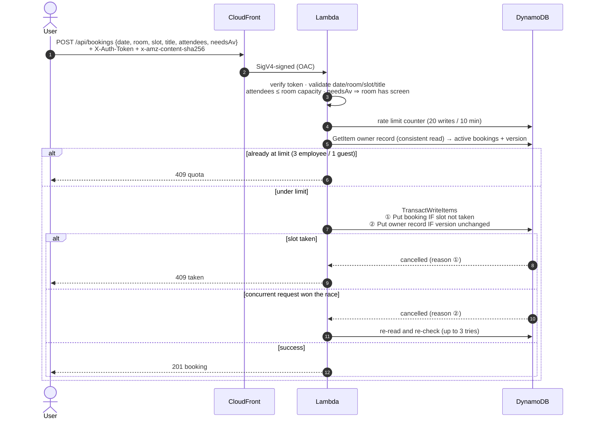
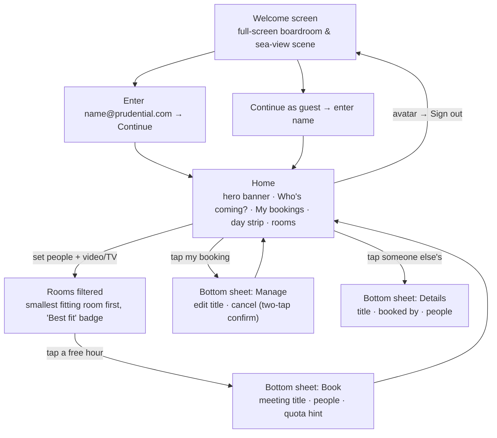
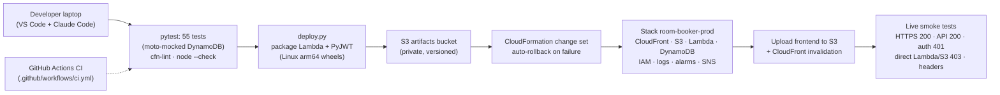

# Room Booker: Design & Architecture

**Live:** https://d3tn1rxaqj7h0y.cloudfront.net · **Region:** us-east-1 · **Infrastructure as code:** [infra/template.yaml](infra/template.yaml)

Room Booker lets Prudential staff, and guests, book meeting rooms by the hour. People sign in with an `@prudential.com` email (no password) or continue as a guest. They say how many people are coming and whether they need video/TV, and see only the rooms that fit.
- Employees can hold **3** upcoming bookings; guests can hold **1**.
- Double-booking is impossible.
- Bookings can be created, viewed, edited and cancelled.

> Diagrams use Mermaid. They render on GitHub and in VS Code (with a Mermaid preview extension). Each one has a short text summary beside it.

---

## 1. System architecture



**How the three required services are wired**
| Service | Role | How access is locked down |
|---|---|---|
| **S3** | Hosts the frontend as a **static website** | The bucket policy allows `s3:GetObject` only when the request carries a secret `Referer` value that only CloudFront sends. Opening the S3 website URL directly returns **403**. ACLs are disabled. Versioning is on, so a bad upload can be rolled back. |
| **Lambda** | All backend logic behind a **Function URL** | `AuthType: AWS_IAM`. Only this CloudFront distribution may invoke it (Origin Access Control plus a resource policy scoped by `SourceArn`). A direct call to the Function URL returns **403**. |
| **DynamoDB** | Stores and retrieves all data | The Lambda role is limited to `GetItem/PutItem/UpdateItem/DeleteItem/Query` on this one table and `Query` on its one index. It has no `Scan` and no access to anything else. |

**Why CloudFront is in front:** it provides HTTPS (S3 website endpoints only speak HTTP), adds security headers, and puts page and API on **one origin**. Because the browser never makes a cross-origin call, the API needs **no CORS configuration**, and browsers block cross-site calls by default.

---

## 2. Request flows

### 2a. Sign-in (employee or guest)



### 2b. Creating a booking (quota enforced atomically)



The transaction makes the quota race-proof. **Verified live: 6 parallel requests from one employee produced exactly 3 bookings and 3 × `409`.**

---

## 3. Data model: single DynamoDB table

| Item | `pk` | `sk` | Key attributes | Purpose |
|---|---|---|---|---|
| **Booking** | `2026-10-13` | `Everest#10:00` | `ownerSub`, `ownerKind`, `ownerName`, `title`, `attendees`, `gsi1pk="BOOKING"`, `gsi1sk="2026-10-13#10:00#Everest"`, `expiresAt` | A day's bookings come back in one `Query`. Room and slot form the key, so a conditional put makes double-booking impossible. |
| **Owner** | `USER#emp:ana.lim@prudential.com` or `USER#guest:<random>` | `PROFILE` | `active = {bookingKey: date}`, `version`, `expiresAt` | The quota counter, updated in the same transaction as the booking. |
| **Rate limit** | `RATE#<sub>` or `RATE#IP#<sha256>` | `<window>` | `hits`, `expiresAt` | Fixed-window counters. IPs are stored only as hashes. |

**Index `upcoming`** (`gsi1pk`, `gsi1sk`) serves "all upcoming bookings" and "my upcoming/past bookings" with a `Query` instead of a full-table `Scan`.
**TTL (`expiresAt`)** deletes bookings 90 days after their date and expires old rate-limit windows. "My bookings → Past" shows the last 30 days.

---

## 4. API

| Method & path | Auth | Purpose |
|---|---|---|
| `GET /api/config` | public | Rooms (capacity, floor, features, `av`), slots, limits, company domain |
| `POST /api/session` | public | `{email}` → employee session · `{guest:true,name}` → guest session |
| `GET /api/me` | session | Current user, `upcoming` and `past` bookings, quota |
| `GET /api/bookings?date=` | session | One day's bookings, or all upcoming if no date. Responses never include owner ids or emails, only a display name and a `mine` flag. |
| `POST /api/bookings` | session | Create (validates capacity, video/TV, quota, double-booking) |
| `PATCH /api/bookings/{date}/{room}/{slot}` | owner | Change the meeting title |
| `DELETE /api/bookings/{date}/{room}/{slot}` | owner | Cancel; frees the quota place in the same transaction |

Errors are JSON `{error, code}`. The codes are `domain`, `auth`, `capacity`, `av`, `quota`, `taken`, `rate` and `retry`, so the UI can respond appropriately.

---

## 5. Frontend design

### Screen flow



### Home layout

```
┌──────────────────────────────────────────────────────────────┐
│ [P] PRUDENTIAL            Room Booker                    (AL) │  frosted-glass navbar
├──────────────────────────────────────────────────────────────┤
│  ╔════════════════════════════════════════════════════════╗  │
│  ║  windows · sea · islands · sailboats · plane ✈         ║  │  hero: animated scene
│  ║  Good morning, Ana                                     ║  │  (day / night SVG)
│  ║  Book a room                              [GUEST]      ║  │
│  ╚════════════════════════════════════════════════════════╝  │
│  ┌ Who's coming? ──────────┐  ┌ My bookings ─────────────┐   │
│  │ People      [ − 6 + ]   │  │ (◔ 2/3)  1 of 3 left      │   │
│  │ (2)(4)(8)(12)(20)(40)   │  │ [ Upcoming | Past ]       │   │
│  │ Video / TV needed  (●─) │  │ • Quarterly review · Mon  │   │
│  │ 4 of 6 rooms fit        │  │ • Design review  · Wed    │   │
│  └─────────────────────────┘  └───────────────────────────┘   │
│  Tomorrow                                         [Today]     │
│  (SUN 11)(MON 12)(TUE 13)(WED 14) …  ← scrollable day strip   │
│  ┌ Denali   [Best fit] ┐ ┌ Everest ──────┐ ┌ Matterhorn ──┐   │
│  │ L12 · seats 8  9free│ │ L12 · seats 12│ │ L10 · 20     │   │  room cards
│  │ TV · Video conf.    │ │ TV · VC · WB  │ │ Video wall … │   │
│  │ 08 09 10 11 12      │ │ 08 09 10 ⓫ 12 │ │ …            │   │  hour buttons:
│  │ 13 14 15 16 17      │ │ 13 ⓮ 15 16 17 │ │              │   │  free · ⓮ yours · ⓫ booked
│  └─────────────────────┘ └───────────────┘ └──────────────┘   │
│  2 rooms are hidden because they're too small or have no TV.  │
│  All upcoming bookings (grouped by day)                        │
└──────────────────────────────────────────────────────────────┘
```

**Design language (Apple-inspired):**
- **Type and colour:** system font (SF Pro on Apple devices); Prudential red as the only accent colour.
- **Surfaces:** frosted-glass bars; large-title header; cards with 22 px corner radius.
- **Controls:** iOS-style segmented controls, stepper and switch.
- **Motion:** a bottom sheet with a spring-like curve on phones, a centred sheet on desktop.
- **Themes and accessibility:** automatic light and dark themes, with a night version of the scene; motion is reduced when the user asks for it.

**Scenery:** [tools/make_scene.py](tools/make_scene.py) generates `scene-day.svg` and `scene-night.svg`. They're animated with SMIL only, never `<style>`, because the site's CSP applies to the SVG files too.

**Branding:** a "Prudential" wordmark appears until the official logo is placed at `frontend/assets/logo.svg`. The footer says it's an internal demo, not an official Prudential system.

**Rooms**
| Room | Seats | Floor | Video/TV | Features |
|---|---|---|---|---|
| Fuji | 4 | Level 11 | ✓ | TV screen, Whiteboard |
| Kilimanjaro | 6 | Level 12 | ✗ | Whiteboard, Natural light |
| Denali | 8 | Level 12 | ✓ | TV screen, Video conferencing |
| Everest | 12 | Level 12 | ✓ | TV screen, Video conferencing, Whiteboard |
| Matterhorn | 20 | Level 10 | ✓ | Video wall, Video conferencing, Speakerphone |
| Olympus | 40 | Level 3 | ✓ | Projector, Video conferencing, Stage mic |

---

## 6. Security & production controls

| Layer | Control |
|---|---|
| **Transport** | HTTPS only (HTTP redirects); HSTS for 2 years |
| **Browser** | CSP `default-src 'none'` with scripts, styles and connections from self only; `frame-ancestors 'none'`; nosniff; Referrer-Policy; Permissions-Policy. All user text is rendered with `textContent`, so no XSS sink. |
| **Origin isolation** | Lambda Function URL uses IAM auth and is reachable only via this CloudFront distribution (OAC). The S3 bucket answers only CloudFront's secret Referer. Smoke tests check both return 403. |
| **CORS** | Not needed: page and API share one origin, so cross-origin requests are refused by default |
| **Identity** | Signed HS256 sessions; the server enforces the company domain exactly. Guests get random ids. **Known gap:** email-only sign-in is trust-based (no password or code, by product decision). The next step is an emailed one-time code or corporate SSO. |
| **Authorisation** | Edit and cancel are conditioned on `ownerSub` inside the DynamoDB write itself, so others get 403 |
| **Input validation** | Room and slot allow-lists; real dates within 60 days; attendees 1 to room capacity; video/TV matches the room; title ≤ 100 chars; control characters stripped; 2 KB body cap |
| **Abuse limits** | 20 writes per 10 min per user (and per IP for guests); 5 guest sessions per IP per hour; quotas 3 / 1 |
| **Least privilege** | One inline IAM policy: item operations on one table and `Query` on one index; write own log group; X-Ray put |
| **Data protection** | Point-in-time recovery, deletion protection, `DeletionPolicy: Retain`, encryption at rest, TTL cleanup |
| **Privacy** | Logs record method, path, status and latency only, never names, emails, titles or tokens. API responses hide owner ids and emails. IPs are stored only as hashes. |
| **Operations** | CloudWatch alarms for Lambda errors, throttles and CloudFront 5xx rate, sent to SNS (email optional via `--alert-email`); X-Ray tracing |

---

## 7. Build, test & deploy



| File | Purpose |
|---|---|
| [infra/template.yaml](infra/template.yaml) | All infrastructure (CloudFront, S3, Lambda + URL, DynamoDB, IAM, logs, alarms, SNS) |
| [backend/lambda_function.py](backend/lambda_function.py) | The API |
| [frontend/](frontend/) | `index.html`, `app.js`, `styles.css`, `assets/` (scenes, favicon) |
| [deploy.py](deploy.py) / [teardown.py](teardown.py) | Idempotent deploy with smoke tests / clean removal |
| [tests/test_lambda.py](tests/test_lambda.py) | 55 unit tests |
| [tools/make_scene.py](tools/make_scene.py) | Generates the animated day and night background |

---

## 8. Known limits & next steps
- **Identity:** prove email ownership with a one-time code (Cognito passwordless + Amazon SES production access), or federate with the corporate IdP (Entra ID / Okta) for SSO.
- **Edge protection:** AWS WAF rate-based rules at CloudFront (in-app limits are used today to avoid a fixed monthly cost).
- **Capacity ceiling:** raise the account's Lambda concurrency quota (currently 10) and set `ReservedConcurrency` as a cost cap.
- **Domain:** custom domain via ACM + Route 53 (the `*.cloudfront.net` ID can't be chosen).
- **Environments:** a dev/prod stack per stage, with CI deploying through GitHub OIDC (no long-lived keys).
